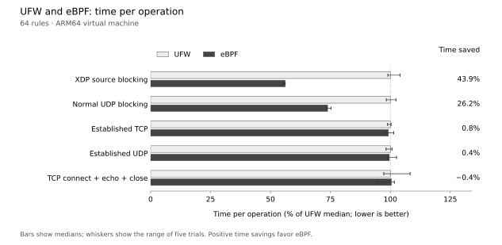

# ebpfw

A UFW-style Linux firewall with stateful eBPF rules for incoming, outgoing, and
routed IPv4/IPv6 traffic. It tracks connections in BPF maps and installs no
nftables rules. Optional XDP acceleration drops explicit source blocks early;
accepted local traffic still uses Linux TCP/IP.

**Experimental software.** Requires Linux 6.6+, kernel BTF, bpffs, Netfilter BPF
links, and IP defragmentation support. Check with `sudo ebpfw doctor`. A kernel
without `/sys/kernel/btf/vmlinux` needs a BTF-enabled kernel; installing headers
or downloading an external BTF file is insufficient for this implementation.
Test in a VM before using it on a production host.

## Build

```sh
nix develop
make all test
sudo make install
sudo systemctl daemon-reload
```

Or use Go 1.25+, Clang 18+ with its BPF backend, and Make. Builds
explicitly target eBPF v3 for 32-bit atomics. Installation copies files and does
not start filtering. Mount bpffs at `/sys/fs/bpf` if needed and configure it to
mount at boot before enabling the firewall.

## Use

New policies are disabled, with incoming/routed deny and outgoing allow.
Allow your administration traffic before enabling; keep console access available.

```sh
sudo ebpfw allow OpenSSH
sudo ebpfw allow 443/tcp
sudo ebpfw default deny incoming
sudo ebpfw default allow outgoing
sudo ebpfw check
sudo ebpfw --dry-run enable
sudo ebpfw enable
sudo ebpfw status numbered
```

More examples:

```sh
sudo ebpfw allow in on eth0 proto tcp from 192.0.2.0/24 to any port 8443
sudo ebpfw allow out proto udp to 198.51.100.53 port 53
sudo ebpfw route allow in on lan0 out on wan0 proto tcp to any port 443
sudo ebpfw limit 22/tcp rate 12/minute burst 6
sudo ebpfw reject 23/tcp
sudo ebpfw app set Cameras 554/tcp 8554/tcp
sudo ebpfw allow Cameras
sudo ebpfw insert 1 allow 2222/tcp
sudo ebpfw delete 3
sudo ebpfw logging on
sudo ebpfw stats
sudo ebpfw disable
```

Use `ebpfw help` for all commands. Rules are ordered; existing connections survive
ordinary rule changes. `block from CIDR` also blocks existing state. Optional
`accelerate INTERFACE native` (or `generic`) accelerates those source blocks with
XDP; packet logging pauses acceleration. Loopback, local IPv6 discovery, and
incoming DHCP replies have base allowances that explicit rules can override.

Configuration lives in `/etc/ebpfw/rules.json`. Installed `enable` starts
`ebpfw.service`; foreground `ebpfw run` is also supported. Pinned kernel links
keep filtering if the service stops or crashes. Use `disable` to detach. Logs,
best-effort reject replies, and expired-state cleanup need the running agent.
A changed BPF object requires a reviewed disable/enable upgrade, with a brief
enforcement gap. The flow table holds 65,536 entries and fails closed when full.

This is not a drop-in UFW replacement: no NAT, connection helpers, bridge-layer
filtering, or UFW configuration-file compatibility. Connection limiting uses a
token bucket. TCP tracking is a new implementation without an independent
security audit. IPv6 jumbograms and extension chains beyond 32 headers are
unsupported. Legacy v0.1 policies migrate disabled for review.

## Benchmark



**Blocking was faster; accepted traffic was approximately equal.** At 64 rules,
source IP blocking with ebpfw’s XDP acceleration took about **44% less time**
and UDP port blocking through its standard eBPF hooks about
**26% less time**. Small accepted-traffic differences overlap observed variation;
these results do not establish faster streaming or greater network throughput.

Method: real UFW 0.36.2 using `iptables-nft`, compared with ebpfw in separate
network/mount namespaces over veth. Five repetitions at 1, 16, and 64 rules,
alternating backend order: 150 trials. Each drop trial verifies 5,000 frames;
established TCP/UDP trials verify 1,000 64-byte echo round trips; new TCP trials
verify 50 connect/echo/close operations. Logging is off.

Every row compares UFW with ebpfw. Only ebpfw uses generic XDP in the source IP
blocking test; the other rows use its standard Netfilter eBPF hooks. UFW uses
`iptables-nft` throughout, with equivalent absolute source blocks before its
established-flow acceptance rules. UFW does not use XDP.

Recorded on 2026-11-03 from `fef330d` with Clang 21.1.8, before the compiler
portability repair: Linux 6.12.114, ARM64 QEMU 10.2.4/HVF, two vCPUs, 1.5 GiB RAM,
Apple M5 host. This is a VM measurement, not physical-NIC or Pi performance.
[Raw samples](benchmarks/results.jsonl) and [graph generator](benchmarks/plot.py)
are included; older reports and logs remain in Git history.

## Test and reproduce

```sh
make test                                  # unit tests, race detector, vet
sudo env PATH="$PATH" make test-kernel       # live kernel tests
sudo env PATH="$PATH" make benchmark         # real UFW comparison
python3 benchmarks/plot.py                  # redraw the recorded graph
```

Kernel tests and benchmarks require a disposable Linux machine with BTF and
BPF privileges. The benchmark also requires UFW. Both Make targets create
private network/mount namespaces and private bpffs; they never attach to a real
NIC. The live suite covers IPv4/IPv6, state, routing, fragments, selectors,
limits, rejects, XDP, reloads, and agent crashes. CI runs these tests and offers
the benchmark as a manual input. Chart generation uses Matplotlib, included in
the Nix shell.

## License

Go/Python: Apache-2.0. BPF C: GPL-2.0-only. See `LICENSE` and `bpf/LICENSE`.
